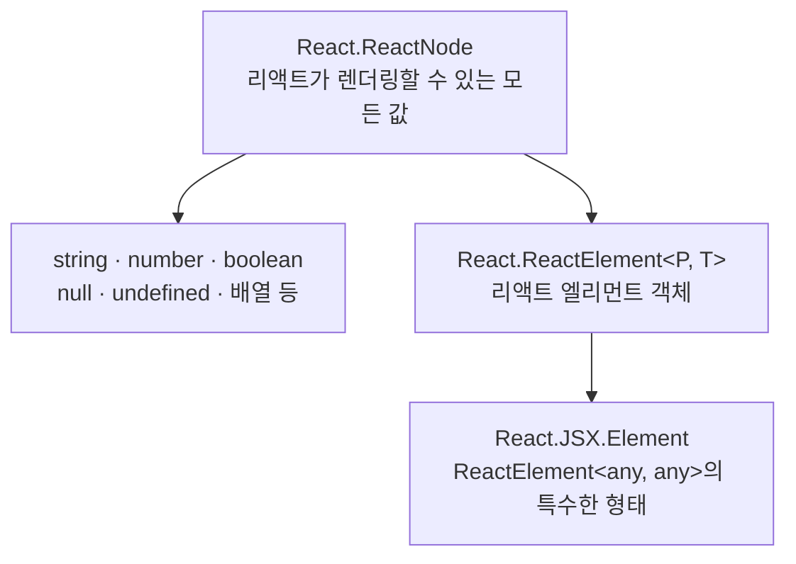

# 8장 JSX에서 TSX로

## 8.1 리액트 컴포넌트의 타입

### 클래스 컴포넌트 타입

리액트의 클래스 컴포넌트는 `React.Component`를 상속하고 제네릭으로 props와 state의 타입을 지정한다.

```ts
interface Component<P = {}, S = {}, SS = any>
  extends ComponentLifecycle<P, S, SS> {}

class Component<P, S> {
  /* 생략 */
}

class PureComponent<P = {}, S = {}, SS = any> extends Component<P, S, SS> {}
```

- `P`: 컴포넌트가 전달받는 props의 타입
- `S`: 컴포넌트가 관리하는 state의 타입
- `SS`: `getSnapshotBeforeUpdate`가 반환하는 스냅샷의 타입

props만 있다면 첫 번째 제네릭만 전달하면 된다.

```tsx
interface WelcomeProps {
  name: string;
}

class Welcome extends React.Component<WelcomeProps> {
  render() {
    return <h1>Hello, {this.props.name}</h1>;
  }
}
```

state도 사용한다면 두 번째 제네릭에 state 타입을 전달한다.

```tsx
interface WelcomeState {
  count: number;
}

class Welcome extends React.Component<WelcomeProps, WelcomeState> {
  state: WelcomeState = { count: 0 };

  render() {
    return <div>{this.state.count}</div>;
  }
}
```

### 함수 컴포넌트 타입

함수 컴포넌트는 props의 타입과 함수의 반환 타입을 지정해서 표현할 수 있다.

```tsx
interface WelcomeProps {
  name: string;
}

// 함수 선언문
function Welcome({ name }: WelcomeProps): React.JSX.Element {
  return <h1>Hello, {name}</h1>;
}

// React.FC 사용
const WelcomeWithFC: React.FC<WelcomeProps> = ({ name }) => {
  return <h1>Hello, {name}</h1>;
};

// props 타입과 반환 타입을 직접 지정
const WelcomeDirect = ({ name }: WelcomeProps): React.JSX.Element => {
  return <h1>Hello, {name}</h1>;
};
```

책에 나온 예전 타입 정의에서는 `React.FC`가 `PropsWithChildren<P>`를 사용해 `children`을 자동으로 포함했고, `React.VFC`는 `children`을 포함하지 않았다.

```ts
// 과거 타입 정의를 단순화한 형태
type FC<P = {}> = FunctionComponent<P>;

interface FunctionComponent<P = {}> {
  (props: PropsWithChildren<P>, context?: any): ReactElement<any, any> | null;
}

type VFC<P = {}> = VoidFunctionComponent<P>;

interface VoidFunctionComponent<P = {}> {
  (props: P, context?: any): ReactElement<any, any> | null;
}
```

현재 기준에서는 다음과 같이 이해해야 한다.

- React 18 타입부터 `React.FC`가 `children`을 암묵적으로 추가하지 않는다.
- `children`을 받는 컴포넌트라면 props에 `children`을 직접 선언한다.
- `React.VFC`는 더 이상 사용할 이유가 없으며 최신 타입에서는 제거되었다.
- `React.FC<Props>`를 사용하거나 매개변수에 props 타입을 직접 지정할 수 있다. 팀의 규칙에 따라 한 방식을 일관되게 사용하면 된다.

```tsx
interface LayoutProps {
  children: React.ReactNode;
}

function Layout({ children }: LayoutProps) {
  return <main>{children}</main>;
}
```

### 컴포넌트의 반환값을 표현하는 타입

#### `React.ReactElement`

`ReactElement`는 JSX가 변환되어 만들어지는 리액트 엘리먼트 객체의 타입이다. 화면에 그릴 내용을 담은 가상 DOM의 구성 단위라고 이해할 수 있다.

컴포넌트 타입과 props 타입을 제네릭으로 표현할 수 있다.

```ts
React.ReactElement<Props, typeof Component>
```

특정한 리액트 엘리먼트 하나를 요구할 때 유용하다.

#### `React.JSX.Element`

`React.JSX.Element`는 JSX 표현식의 결과 타입이다. 리액트 환경에서는 사실상 `ReactElement<any, any>`를 확장한 타입으로 볼 수 있다.

```ts
declare global {
  namespace React.JSX {
    interface Element extends React.ReactElement<any, any> {}
  }
}
```

따라서 함수 컴포넌트가 JSX 엘리먼트를 반환한다는 것을 명시할 때 사용할 수 있다. 예전 코드에서는 전역 타입인 `JSX.Element`를 많이 사용하지만, 최신 타입에서는 `React.JSX.Element` 표기가 더 명확하다.

#### `React.ReactNode`

`ReactNode`는 리액트가 렌더링할 수 있는 모든 값을 나타내는 가장 넓은 타입이다.

- `ReactElement`
- 문자열과 숫자
- 배열과 fragment
- `null`, `undefined`, `boolean`
- 그 밖에 리액트가 렌더링할 수 있는 값

특히 `children`처럼 어떤 렌더링 가능한 값이든 받을 수 있어야 하는 props에 주로 사용한다.

```tsx
interface CardProps {
  children: React.ReactNode;
}
```

#### 포함 관계



엄밀히 말하면 타입스크립트의 집합 관점에서 `React.JSX.Element`는 `ReactElement<any, any>`와 거의 같은 범위를 가지지만, 개념적으로는 위와 같이 좁혀 이해할 수 있다.

| 타입 | 의미 | 주 사용처 |
| --- | --- | --- |
| `React.ReactElement` | JSX로 생성되는 엘리먼트 객체 | 특정 엘리먼트를 props로 받거나 반환할 때 |
| `React.JSX.Element` | JSX 표현식의 결과 | 컴포넌트의 JSX 반환 타입을 명시할 때 |
| `React.ReactNode` | 리액트가 렌더링할 수 있는 모든 값 | `children` 등 렌더링 가능한 내용을 받을 때 |

### 기본 HTML 요소의 props 타입 활용하기

래퍼 컴포넌트를 만들 때 리액트가 제공하는 타입을 사용하면 특정 HTML 태그가 지원하는 속성을 그대로 받을 수 있다.

#### `DetailedHTMLProps`

`React.DetailedHTMLProps`는 HTML 속성과 함께 `key`, `ref` 같은 클래스 속성도 포함한다.

```ts
type ButtonProps = React.DetailedHTMLProps<
  React.ButtonHTMLAttributes<HTMLButtonElement>,
  HTMLButtonElement
>;
```

하지만 일반 함수 컴포넌트는 전달받은 `ref`를 자동으로 내부 DOM 요소에 연결하지 않는다. 타입에 `ref`가 존재한다는 이유만으로 실제 ref 전달이 동작한다고 오해할 수 있으므로 래퍼 컴포넌트의 props 타입으로는 주의해서 사용해야 한다.

#### `ComponentPropsWithoutRef`

일반 함수 컴포넌트가 특정 HTML 요소의 속성을 그대로 확장한다면 `ComponentPropsWithoutRef`를 사용하는 편이 안전하다. 해당 태그의 props는 모두 포함하되 `ref`는 제외한다.

```tsx
type ButtonProps = React.ComponentPropsWithoutRef<"button"> & {
  variant: "primary" | "secondary";
};

function Button({ variant, ...props }: ButtonProps) {
  return <button data-variant={variant} {...props} />;
}
```

#### ref도 전달해야 하는 경우

React 18 이하에서는 `forwardRef`와 `ComponentPropsWithoutRef`를 함께 사용해 ref를 명시적으로 전달한다.

```tsx
type ButtonProps = React.ComponentPropsWithoutRef<"button">;

const Button = React.forwardRef<HTMLButtonElement, ButtonProps>(
  (props, ref) => <button ref={ref} {...props} />,
);
```

`HTMLProps`, `DetailedHTMLProps`, `ComponentPropsWithRef`는 `ref`를 포함하고, `ComponentPropsWithoutRef`는 `ref`를 제외한다. 따라서 ref를 실제로 전달하지 않는 래퍼 컴포넌트에는 `ComponentPropsWithoutRef`가 의도를 가장 잘 드러낸다.

